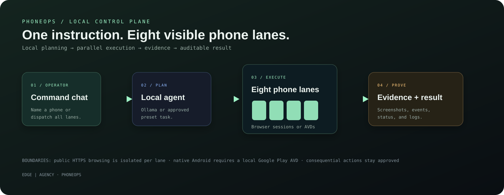

# PhoneOps repository demo

This repository includes a real recorded demo of the local eight-lane PhoneOps wall.

## Demo recording

- [MP4 demo](docs/demo/phoneops-eight-lane-demo.mp4)
- [WebM demo](docs/demo/phoneops-eight-lane-demo.webm)
- [Full-screen browser wall screenshot](docs/screenshots/phoneops-fullscreen-active-browsers.webp)
- [Continuous scrape wall screenshot](docs/screenshots/phoneops-continuous-full-phone-wall.webp)

The recording shows the running dashboard with eight named phone lanes, independent browser content, the Auto-scrape control, and the full-screen wall control. The phone display switches from the launcher to a normal in-phone browser view while active.

## Smoke-test result

The recorded build was tested against the live local service:

```text
PASS: eight worker processes are online
PASS: one targeted health scan completed
PASS: eight-way parallel dispatch completed
PASS: eight browser lanes returned different public pages
PASS: eight full-screen in-phone browser shells rendered
PASS: continuous scraper completed its first eight-lane cycle
PASS: JavaScript syntax validation
PASS: Python compilation
PASS: MP4 ffprobe validation: H.264, 1600x1000, 8.12 seconds
```

Run the repeatable test yourself:

```powershell
python test_kevin.py
```

Run the browser benchmark:

```powershell
python benchmark_browser_farm.py
```

## Architecture map



The local browser mode is ready immediately. Native Android Chrome and Play Store require the Google Play AVD setup on a Windows machine with Android SDK, ADB, emulator tooling, and explicit license acceptance. PhoneOps does not bundle or bypass Google app licensing.
