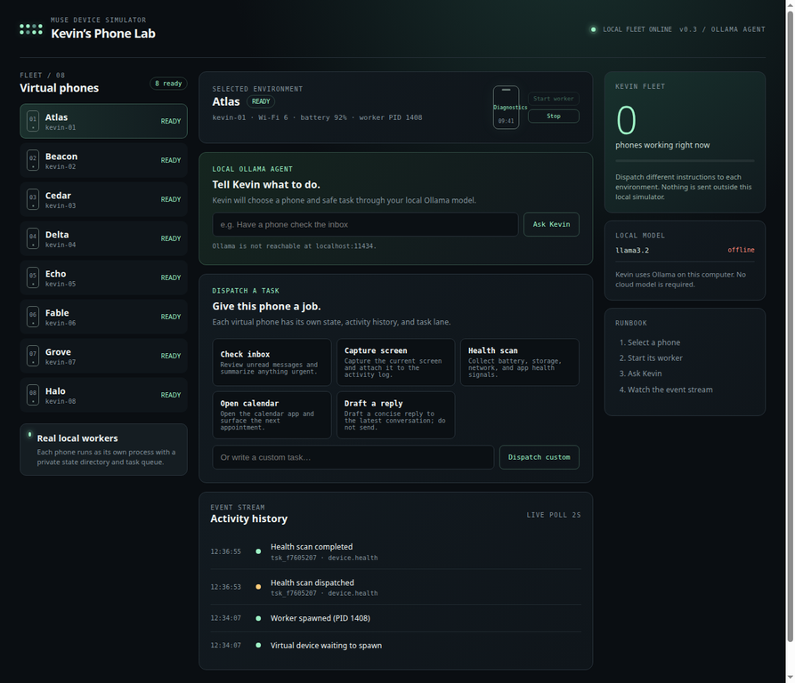

# Kevin’s Muse Phone Lab

Kevin is a local multi-process virtual phone fleet with eight independently taskable workers and a local Ollama agent bridge. The dashboard shows phone state, worker PIDs, task execution events, and Ollama connectivity. The worker processes are lightweight virtual environments, not full Android/iOS emulators.



## Quick start on Windows

Install Ollama Desktop, then pull a model:

```powershell
ollama pull llama3.2
```

Build the local executables:

```powershell
Set-ExecutionPolicy -Scope Process Bypass
.\build-kevin-exe.ps1
.\run-kevin-windows.bat
```

Open `http://localhost:8787` and use **Ask Kevin**. Kevin sends the instruction to Ollama at `http://localhost:11434`, validates the structured phone/task decision, and dispatches it to one worker.

## Test and inspect

With Kevin running:

```powershell
python .\test_kevin.py
Invoke-RestMethod http://localhost:8787/api/state | ConvertTo-Json -Depth 6
Invoke-RestMethod http://localhost:8787/api/ollama/status | ConvertTo-Json
```

Read [LOCAL-TESTING.md](LOCAL-TESTING.md) for worker logs, state directories, process inspection, and model switching. Read [OLLAMA-SETUP.md](OLLAMA-SETUP.md) for build and configuration details.

## Models

```powershell
ollama pull mistral
$env:OLLAMA_MODEL = "mistral"
.\run-kevin-windows.bat

ollama pull deepseek-r1:7b
$env:OLLAMA_MODEL = "deepseek-r1:7b"
.\run-kevin-windows.bat
```

## Safety boundary

The local agent can only select Kevin’s eight phone IDs and the supported task presets. The server validates the model response before dispatch. It does not send messages, access accounts, or control real devices.
