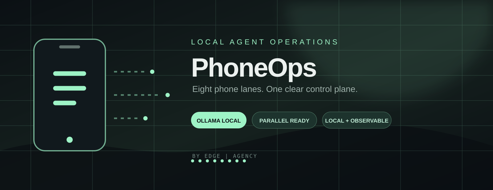
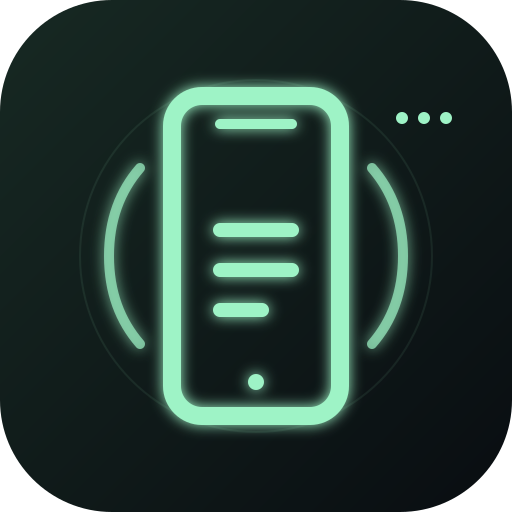
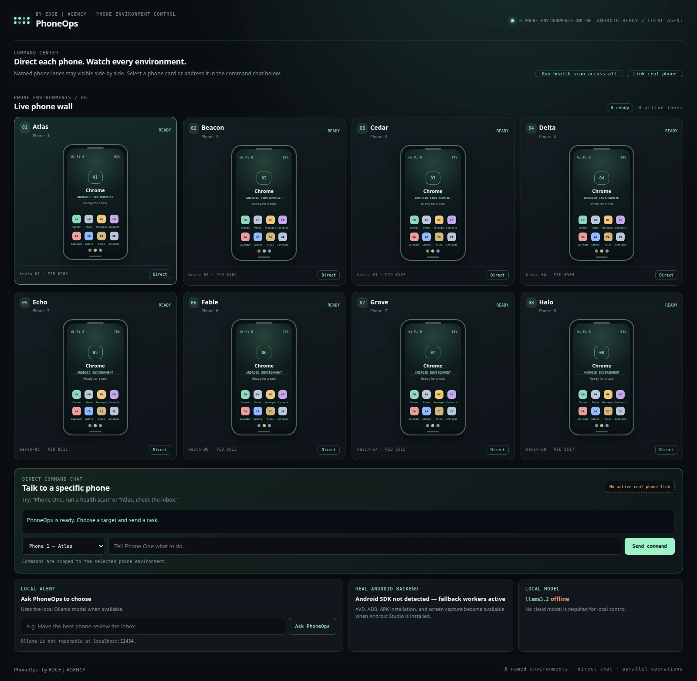

<p align="center">
  
</p>

<p align="center">
  
</p>

<h1 align="center">PhoneOps</h1>

<p align="center"><strong>Local agent operations for phone fleets — by EDGE | AGENCY</strong></p>

<p align="center">
  <a href="https://github.com/EdgeAgent/kevin-muse-phone-lab"></a>
  <a href="https://ollama.com/"></a>
  
  
  
</p>

<p align="center"><a href="#high-value-use-cases-and-prompts">Use cases</a> · <a href="#quick-start-on-windows">Quick start</a> · <a href="REMOTE-LINK.md">Remote Phone Link</a> · <a href="LOCAL-TESTING.md">Testing</a></p>

## Easiest Windows setup

Download or clone this repository and double-click [`Install-PhoneOps.bat`](Install-PhoneOps.bat). It checks prerequisites, optionally offers Android Studio installation, builds the local executables when needed, creates a **PhoneOps** desktop shortcut, and opens the dashboard. See [`ONE-CLICK-SETUP.md`](ONE-CLICK-SETUP.md) for the exact flow. Android SDK licenses are accepted explicitly by the user inside Android Studio; PhoneOps never bypasses that step.

PhoneOps is a local operations console for running, observing, and coordinating multiple phone-oriented agent environments. Its dashboard presents eight named phone environments side by side — Phone One / Atlas through Phone Eight / Halo — with individual phone screens, worker state, app state, battery, PID, and task status. A direct command chat at the bottom lets an operator address a specific phone by number or name while a separate local agent can choose a phone automatically.
Each phone card now shows an Android-style launcher grid with native-looking app tiles for Chrome, Phone, Messages, Contacts, Calendar, Camera, Files, Settings, and Play Store.
The phone wall can also show a different live browser site on every lane; see [`phoneops-eight-browser-phones-closeup.webp`](docs/screenshots/phoneops-eight-live-page-screens.webp).

PhoneOps is built for teams that need repeatable phone workflows without immediately handing sensitive operational data to a cloud agent. When Android SDK tools are unavailable, PhoneOps runs lightweight local workers as a safe fallback. When Android Studio Emulator and ADB are installed, the new backend can manage real Android Virtual Devices, install APKs, run scoped shell commands, and capture device screens. See [ANDROID-EMULATOR.md](ANDROID-EMULATOR.md).

Every PhoneOps environment starts with a visible starter app pack: **Chrome, Phone, Messages, Contacts, Calendar, Camera, Files, Settings, and Play Store**. In fallback mode these are the environment’s seeded app catalog. In real Android mode, use a Google Play AVD image for actual Play Store and Chrome availability; PhoneOps does not redistribute Google APKs or bypass app licensing.

For native Chrome and Play Store, Windows users can double-click [`Setup-PhoneOps-GooglePlay.bat`](Setup-PhoneOps-GooglePlay.bat). It installs the Google Play system image, creates `PhoneOps-01`, and launches the AVD after you explicitly accept Google's SDK licenses.

For immediate web access in the local farm, double-click [`Setup-PhoneOps-Web.bat`](Setup-PhoneOps-Web.bat). Each phone lane then gets an isolated Chromium session with its own search, URL navigation, cookies, page title, and screenshot state. See [`BROWSER-OPERATIONS.md`](BROWSER-OPERATIONS.md) for parallel website checks.

The eight-browser performance audit is documented in [`BROWSER-BENCHMARK.md`](BROWSER-BENCHMARK.md), with raw results in [`browser-benchmark.json`](browser-benchmark.json) and a visual metrics image at [`phoneops-browser-benchmark.webp`](docs/screenshots/phoneops-browser-benchmark.webp).



*Eight named phone environments shown side by side with Chrome, Phone, Messages, Contacts, Calendar, Camera, Files, Settings, and Play Store in the starter app pack, captured after the eight-lane parallel smoke test.*

## Product snapshot

| Capability | What it does |
|---|---|
| Eight worker lanes | Runs eight isolated local worker lanes with independent state and PIDs |
| Real Android mode | Discovers AVDs, launches emulators, installs APKs, and captures screens through ADB |
| Local intelligence | Uses Ollama Desktop through `localhost:11434` |
| Natural-language control | Lets an operator ask PhoneOps to select a phone and approved task |
| Per-phone browser sessions | Searches different websites and captures pages independently in all eight lanes |
| Parallel operations | Dispatches one approved workflow to every ready phone simultaneously |
| Observability | Shows worker state, task events, completion records, and local model status |
| Remote Phone Link | Creates a short-lived pairing token for a future phone-side companion |
| Windows packaging | Builds `kevin-server.exe` and `kevin-phone-worker.exe` with PowerShell |

## Why teams would pay for this

PhoneOps targets operational work where a human repeatedly opens apps, checks states, prepares drafts, captures evidence, or performs the same QA flow across several devices. The commercial value is not “more AI.” The value is a local, auditable control plane that reduces repetitive operator time, makes parallel execution visible, and preserves a clear approval boundary before actions reach a real device.

Potential commercial packaging could include a private operations console for agencies, a local deployment package for regulated teams, a managed workflow library for customer-support operations, and a phone QA command center for product teams. Revenue should be validated with customer interviews and pilots rather than assumed from the prototype alone.

## High-value use cases and prompts

### 1. Mobile QA regression lab

**Buyer:** mobile product teams, QA agencies, app studios.

**Workflow:** assign different phones to smoke-test flows, capture evidence, and report which lanes failed. This is useful for pre-release regression, app-store submission checks, and reproducing device-specific issues.

**Prompt:**

> Run a parallel smoke test across every ready phone. Assign each lane one approved test flow, capture evidence after each step, and return a report grouped by worker ID. Do not submit forms, make purchases, or change account settings.

### 2. Customer-support preparation desk

**Buyer:** support teams, BPOs, SaaS companies, ecommerce operators.

**Workflow:** triage simulated support conversations, identify urgency, draft replies, and leave sending to a human reviewer.

**Prompt:**

> Use three available phones for support preparation. One should identify urgent conversations, one should summarize routine requests, and one should draft concise replies. Do not send anything. Return a handoff list with priority, suggested response, and the responsible worker ID.

### 3. Social-content review pipeline

**Buyer:** creator agencies, social teams, influencer managers, brand studios.

**Workflow:** distribute content review, caption drafting, compliance checks, and screenshot evidence across parallel lanes.

**Prompt:**

> Review the current content queue across four ready phones. Have each phone classify its assigned items as ready, needs edits, or needs human approval. Draft captions but do not publish. Return the result with item count, status, and worker ID.

### 4. Marketplace and ecommerce operations

**Buyer:** marketplace sellers, ecommerce agencies, catalog operators.

**Workflow:** check listing health, identify missing information, prepare edits, and collect evidence without making unsupervised changes.

**Prompt:**

> Run a parallel listing-health review. Check for missing titles, images, prices, and policy warnings. Prepare a correction list only; do not publish or modify a listing. Include the worker ID and evidence location for each issue.

### 5. Appointment and lead-response desk

**Buyer:** real-estate teams, clinics, home-service companies, local sales teams.

**Workflow:** surface upcoming appointments, classify lead urgency, and prepare follow-up drafts for human approval.

**Prompt:**

> Find the next appointment and summarize the preparation needed. On a second phone, identify leads that need a same-day follow-up. Draft messages only and mark every message as NOT SENT.

### 6. Field-service and dispatch readiness

**Buyer:** property managers, field-service operators, logistics coordinators.

**Workflow:** perform readiness checks across worker lanes, verify required information, and create an exception queue.

**Prompt:**

> Run a fleet readiness scan across all eight phones. Report online state, worker PID, battery, last completed task, and any exception. Do not dispatch a technician or alter a schedule.

### 7. Compliance and audit evidence collection

**Buyer:** regulated operations, financial-services vendors, security teams, enterprise back offices.

**Workflow:** capture repeatable evidence, preserve task IDs, and produce a human-reviewable audit trail.

**Prompt:**

> Collect evidence for the approved audit checklist across the ready phones. Capture screen evidence where supported, record timestamps and task IDs, and report missing evidence. Do not access data outside the assigned workspace.

### 8. App-store and release-readiness checks

**Buyer:** mobile publishers, app agencies, startup release teams.

**Workflow:** validate launch state, key screens, account-free flows, and release notes before a build goes live.

**Prompt:**

> Perform a release-readiness pass on every available phone. Check launch, navigation, empty states, and error states. Capture evidence for failures and produce a release-blocker summary. Do not submit the build or change production data.

### 9. Internal training and simulation

**Buyer:** operations academies, support-training providers, enterprise enablement teams.

**Workflow:** create repeatable practice scenarios without exposing real accounts or customer data.

**Prompt:**

> Run a training scenario for eight operators. Give each phone a different support situation, collect the draft response, and score it against the provided rubric. Do not send or publish any response.

### 10. Local agent demonstration and pilot environment

**Buyer:** AI consultancies, automation agencies, innovation teams.

**Workflow:** demonstrate model routing, validation, parallel execution, logs, and human approval in a controlled local environment.

**Prompt:**

> Demonstrate a complete controlled run: inspect fleet readiness, choose three phones for different approved tasks, execute them in parallel, and produce a final status report. Explain what was simulated and what was not performed on a real device.

## Architecture

```text
Operator
   │
   ├── PhoneOps dashboard
   │       ├── eight local worker processes
   │       ├── task queues and event history
   │       └── parallel dispatch controller
   │
   └── Ollama Desktop / local model
           └── structured phone + task plan

Future real-phone path:
PhoneOps pairing link → signed phone companion → authenticated WebRTC/ADB bridge
```

The server validates every model decision against known phone IDs and supported task presets. Parallel execution is bounded to the eight local workers. Real Android mode is opt-in and reports Android as unavailable when the SDK is missing. The Remote Phone Link provides a 15-minute pairing-token lifecycle; live real-phone mirroring still requires a trusted companion. See [ANDROID-EMULATOR.md](ANDROID-EMULATOR.md) and [REMOTE-LINK.md](REMOTE-LINK.md).

## Quick start on Windows

Install Ollama Desktop and pull a local model:

```powershell
ollama pull llama3.2
```

Build and launch PhoneOps:

```powershell
Set-ExecutionPolicy -Scope Process Bypass
.\build-kevin-exe.ps1
.\run-kevin-windows.bat
```

Open `http://localhost:8787`. Use **Ask PhoneOps** for natural-language control, **Run in parallel** for fleet dispatch, **Real Android Mode** for AVD-backed devices, or **Remote Phone Link** for the pairing scaffold.

## Configure local models

```powershell
ollama pull mistral
$env:OLLAMA_MODEL = "mistral"
.\run-kevin-windows.bat

ollama pull deepseek-r1:7b
$env:OLLAMA_MODEL = "deepseek-r1:7b"
.\run-kevin-windows.bat
```

PhoneOps uses Ollama’s local API at `http://localhost:11434`. See [OLLAMA-SETUP.md](OLLAMA-SETUP.md) for model configuration.

## Test and inspect

With PhoneOps running:

```powershell
python .\test_kevin.py
Invoke-RestMethod http://localhost:8787/api/state | ConvertTo-Json -Depth 6
Invoke-RestMethod http://localhost:8787/api/ollama/status | ConvertTo-Json
```

The smoke test verifies eight worker processes, single-phone execution, eight-way parallel execution, and remote pairing-link creation. See [LOCAL-TESTING.md](LOCAL-TESTING.md) for logs, process inspection, state files, and parallel API calls. See [ANDROID-EMULATOR.md](ANDROID-EMULATOR.md) for real-device setup.

## Current status and roadmap

The current release is a local prototype with real worker processes, local model routing, parallel dispatch, observability, Windows build scripts, a remote-link scaffold, and an Android Emulator / ADB adapter. The next production steps are AVD slot orchestration, boot readiness management, live screen streaming, durable event storage, workflow templates, role-based approvals, and customer pilots that measure time saved and error reduction.

## Safety boundary

PhoneOps is designed for explicit, observable, local workflows. The lightweight fallback workers do not access accounts or control real devices. Real Android mode can install and control the AVDs that the operator explicitly selects, so it should be run with test accounts and test APKs. Any real-phone bridge should require explicit user pairing, scoped permissions, encrypted transport, revocable credentials, and human approval for consequential actions.

## License and attribution

PhoneOps is an EDGE | AGENCY project built around a local worker simulator and a Muse-compatible command boundary. The upstream Muse Gadget SDK remains subject to its own license and terms. Review the upstream repository before deploying a real device integration.
